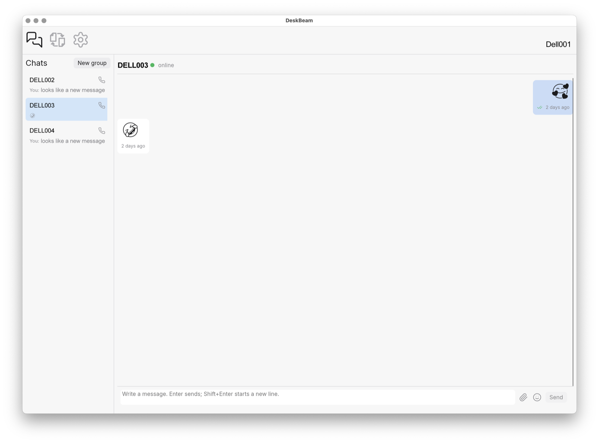
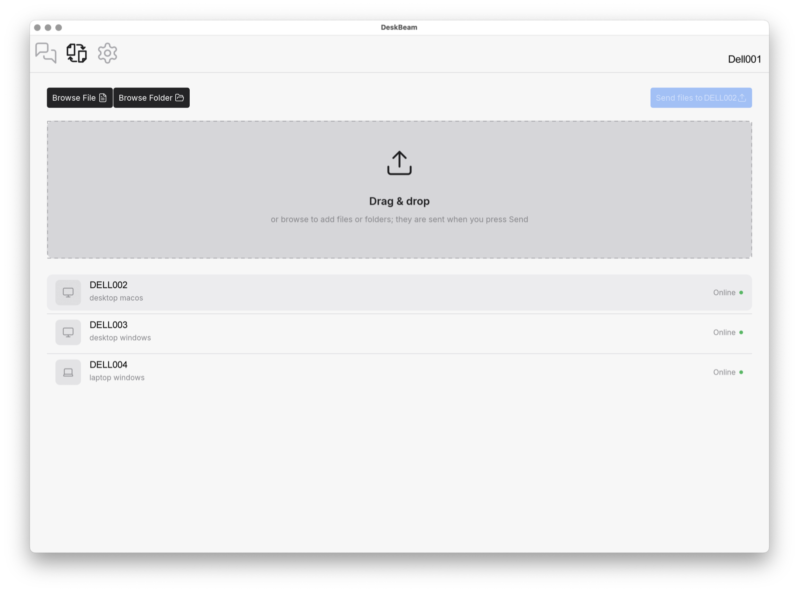
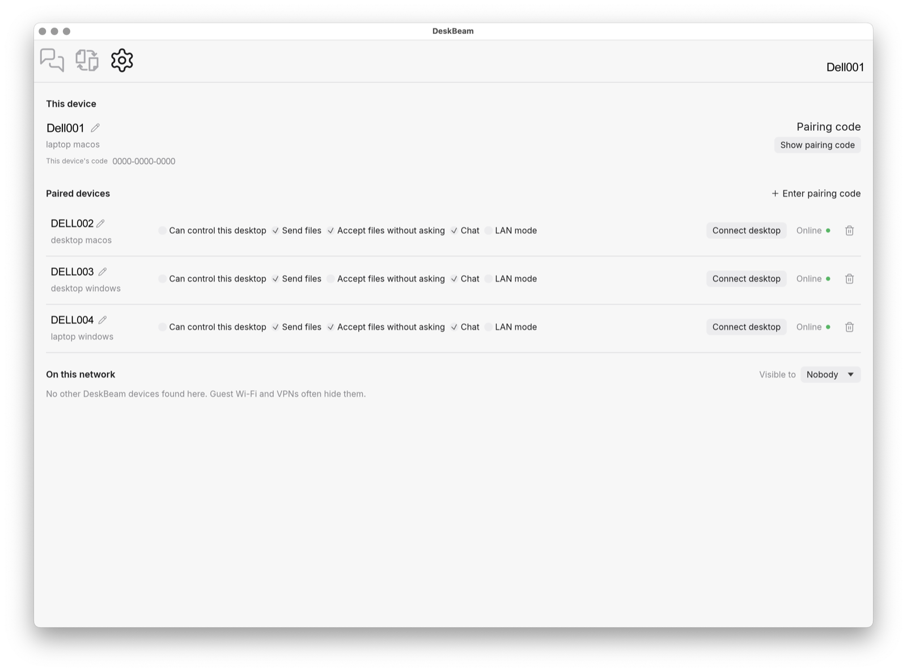
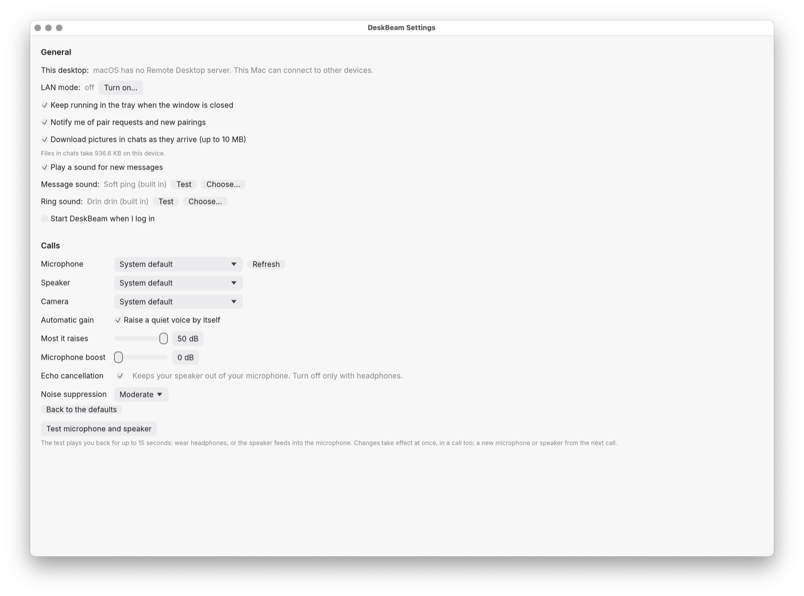

# DeskBeam

Free, open-source desktop app (Windows, macOS, Linux) for your own paired devices:

- **Remote desktop over the internet.** Use Microsoft Remote Desktop (mstsc, Windows App on macOS, FreeRDP on Linux) to reach a paired PC anywhere. You connect to `localhost:<port>` and DeskBeam carries the session over an encrypted peer-to-peer link. No port forwarding, VPN or account is needed.
- **File sharing:** resumable transfers verified with BLAKE3, plus drive and clipboard redirection inside RDP.
- **Messaging:** Skype-style chats and group chats between paired devices, with pictures and files, emoji, replies, editing and deleting, a typing indicator and search across all chats. Messages for an offline device wait on your machine until it comes online.
- **Voice and video calls, with screen sharing:** call a paired device from the chat list. Audio is Opus with echo cancellation, noise suppression and automatic gain; video is H.264 at up to 640×360 or 1280×720; either side can share a whole screen or one window. Calls go straight between the two devices, with no call server.

There are no DeskBeam servers. Devices talk over [iroh](https://www.iroh.computer) (QUIC + TLS 1.3, identified by keys). Relays only help devices find each other through NAT and only ever see encrypted traffic. You can host your own relay (see [`infra/`](infra/README.md)).

> **Status:** early development. Pairing (by code or on the local network), presence, the tray, the remote-desktop tunnel, file transfers, messaging (chats and group chats, with offline delivery), voice and video calls with screen sharing, and LAN mode work. A macOS `.dmg` and a Windows installer can be built (unsigned for now).

## Screenshots

| Chats | Sending files |
| :---: | :---: |
|  |  |
| **Paired devices and permissions** | **Settings** |
|  |  |

## Build

Rust and a C/C++ compiler are needed: a few dependencies build C or C++ code (SQLite, `ring`, and OpenH264 for video calls). On Windows that is the Visual Studio Build Tools with "Desktop development with C++"; on macOS the Xcode Command Line Tools (`xcode-select --install`); on Linux `gcc` and `g++`. The UI is [egui](https://github.com/emilk/egui), so there is no Node.js.

```sh
cargo run                          # the desktop app (same as cargo run -p deskbeam)
cargo run -p deskbeam-cli -- --help  # the same engine without a window
cargo test --workspace             # every crate's tests (a plain cargo test covers only the app)
cargo xtask ci                     # fmt, layer check, clippy, tests

# A throwaway identity, e.g. to try two devices on one machine:
DESKBEAM_DATA_DIR=/tmp/deskbeam-2 cargo run
cargo xtask icon                   # remake the .ico and .icns from apps/deskbeam/assets/deskbeam.png
cargo xtask bundle                 # macOS: target/bundle/DeskBeam.app and DeskBeam-<version>-macos.dmg
```

Linux needs the usual egui/wgpu system libraries (X11 or Wayland, plus `libxkbcommon`), ALSA's development files for sound (`libasound2-dev` on Debian and Ubuntu, `alsa-lib-devel` on Fedora), and for screen sharing in calls PipeWire's, XCB's and Wayland's development files and libclang (`libpipewire-0.3-dev libxcb1-dev libwayland-dev libclang-dev` on Debian and Ubuntu, `pipewire-devel libxcb-devel wayland-devel clang-devel` on Fedora).

**NASM, for fast video on x86 (Windows, Intel Macs).** OpenH264, the video codec of calls, has hand-written x86 assembly that is built with [NASM](https://www.nasm.us). Without NASM the build still works but quietly uses plain C instead, so video calls take more CPU. It is only needed to build; DeskBeam doesn't ship it. Apple Silicon and other ARM builds don't use it.

- **Windows**, in cmd:
  ```bat
  winget install NASM.NASM
  where nasm
  ```
  If `where nasm` finds nothing, add the folder holding `nasm.exe` to `Path` (System Properties → Environment Variables; usually `C:\Program Files\NASM`, or `%LOCALAPPDATA%\bin\NASM` for a per-user install), then open a new cmd window and check with `nasm -v`.
- **macOS:** `brew install nasm` (used for the Intel half of the universal app).
- **Linux:** `sudo apt install nasm` (Debian and Ubuntu) or `sudo dnf install nasm` (Fedora).

If DeskBeam was built before NASM was installed, build OpenH264 again so it picks NASM up:
```sh
cargo clean --release -p openh264-sys2   # add --target x86_64-apple-darwin for the Intel half of a universal Mac build
```

### Packages

**macOS.** `cargo xtask bundle` builds `target/bundle/DeskBeam.app` and `DeskBeam-<version>-macos.dmg`: one universal app for Apple Silicon and Intel Macs (it needs `rustup target add aarch64-apple-darwin x86_64-apple-darwin`; `--native` builds for this Mac only, quicker). Open the `.dmg` and drag DeskBeam to Applications. The app is signed ad hoc, not with an Apple Developer ID, so on a Mac it was copied to macOS refuses it the first time ("cannot be opened" / "damaged"). Either right-click it → Open → Open, or run once:

```sh
xattr -dr com.apple.quarantine /Applications/DeskBeam.app
```

**Windows.** The Release workflow (`.github/workflows/release.yml`, run from the Actions tab or by pushing a `v*` tag) builds `DeskBeam-<version>-windows-x64-setup.exe` and a portable `.zip`, both with `wintun.dll` for LAN mode, and the macOS `.dmg`. The installer is an [Inno Setup](https://jrsoftware.org/isinfo.php) script, [`apps/deskbeam/packaging/windows/deskbeam.iss`](apps/deskbeam/packaging/windows/deskbeam.iss); it installs for all users under Program Files. Unsigned, so SmartScreen warns once: More info → Run anyway.

If the window cannot open with the GPU ("WGPU error: Parent device is lost", seen on older Intel Macs), DeskBeam starts again with OpenGL by itself. `DESKBEAM_RENDERER=glow` picks OpenGL from the start. Macs can pair, chat and send files; they cannot be controlled over Remote Desktop (macOS has no RDP server), but they can connect to a Windows PC.

### LAN mode

LAN mode puts this device and the paired devices you allow on a private network (addresses in `100.88.0.0/16`), so anything that works on a local network works between them: `ping`, file shares, games, Remote Desktop to the address. Both devices must tick **LAN mode** for each other, and both must turn it on (Settings → LAN mode). A device in your LAN can reach every service on this computer, so allow only devices you trust.

The network adapter needs administrator rights. DeskBeam itself never runs with them: turning LAN mode on starts a small helper (DeskBeam's own program with `--lan-helper`) through the system's prompt (the password dialog on macOS, UAC on Windows, polkit on Linux). The helper only moves packets between the adapter and DeskBeam, and exits, removing the adapter, when LAN mode is turned off or DeskBeam quits. Windows needs `wintun.dll` (from [wintun.net](https://www.wintun.net)) next to `deskbeam.exe`; the installer and the `.zip` ship it.

To check the adapter alone: `sudo cargo run -p deskbeam-lan --example adapter`, then `ping 100.88.0.2` in another terminal.

### Calls

Calls go with the **Chat** permission: you can call, and be called by, the paired devices you chat with. Press the phone icon on a device's row in the chat list. Incoming calls ring, with a notification and a ring sound, and never answer themselves. Both devices must be online; nothing is queued.

- **During a call** the bar under the header has mute (with a level meter), the camera, **Share screen** and hang up. Video opens in its own window: the other side's picture, yours small in a corner, Full screen, and for a shared screen **Actual size** to read small text.
- **Screen sharing** shows a display or one window, picked from a list with small pictures (DeskBeam's own windows are left out). It replaces your camera while it lasts, a red "You are sharing …" bar with Stop stays up the whole time, and it stops when the call ends. The other side only watches; controlling a computer is what Remote Desktop is for.
- **Settings → Calls:** microphone, speaker and camera; automatic gain and its maximum; a fixed microphone boost; echo cancellation (turn off only with headphones); noise suppression; camera quality (Standard 640×360 or HD 1280×720); and **Test microphone and speaker**, which plays you back through the whole call path for up to 15 seconds (wear headphones). Changes reach a call in progress at once; a new device or camera quality applies from the next call or the next time the camera is turned on.
- **Permissions:** macOS asks once for the microphone and the camera. Screen sharing needs **Screen Recording** (System Settings → Privacy & Security); without it macOS would only show your wallpaper, so DeskBeam asks for it and says so. After allowing it, quit and reopen DeskBeam. On Windows, check the microphone and camera privacy switches if a device doesn't open.
- **Calls with an older DeskBeam** stay audio-only: video and sharing need both devices on a build that has them.
- **Bandwidth:** audio is about 32 kbit/s; the camera 0.15–1.5 Mbit/s (HD up to 3); a shared screen 0.3–2.5 Mbit/s at 10 pictures a second. Video follows the loss the other side reports and pauses before the audio suffers. Through a relay, quality depends on the relay's distance and load.

If a call sounds wrong, record it: start DeskBeam with `DESKBEAM_CALL_RECORD=<folder>` and each call writes `call-<time>/` there when it ends, with the microphone, the processed microphone, what was decoded and what the speaker got (`1-microphone.wav` … `4-speaker.wav`) and a `summary.txt` of packets and dropouts. Comparing both sides' recordings shows where a problem starts. `cargo run --release -p deskbeam-call --example loopback` (audio), `--example camera` and `--example screen` try each part on one machine without a network.

### Using the CLI

```sh
deskbeam-cli commands                          # every command id
deskbeam-cli status                            # this device and its paired devices, as JSON
deskbeam-cli run pairing.open --stay           # show a pairing code and wait
deskbeam-cli run pairing.join '{"code":"…"}'   # pair with another device
deskbeam-cli --data-dir /tmp/second daemon     # a second identity on the same machine
deskbeam-cli status && deskbeam-cli run nearby.requestPair '{"endpointId":"…"}' --settle 5
                                               # ask a device on this network to pair
deskbeam-cli run rdp.connect '{"endpointId":"…","launch":false}' --settle 5 --stay
                                               # tunnel to a paired PC's Remote Desktop; prints the port
deskbeam-cli run lan.start --stay              # LAN mode, until Ctrl-C (asks for admin rights)
```

## Security model

DeskBeam connects your own paired devices to each other, with no DeskBeam server in between. This is what protects that, and what it doesn't cover.

**Identity and encryption.** Each device has its own key pair, made on first start; its public key is its device ID. Every connection is QUIC with TLS 1.3 between the two devices' keys, so messages, files, calls, video and Remote Desktop sessions are encrypted end to end. The private key never leaves the device. Pairing records the other device's key, and from then on only the holder of that key is that device.

**Relays.** When two devices can't reach each other directly, their traffic goes through a relay (n0's public relays by default). A relay passes along packets it can't read, and can't pose as either device, since it doesn't have their keys. Its operator does see:
- each device's public IP address and port (the device connects to the relay, like to any website);
- each device's ID, which doesn't change, so when a device is online and from which IPs;
- which devices talk to each other, when, and how much traffic (a 40-minute stream at video-call rates looks like a video call).

A relay can also slow down or drop traffic. Running your own relay keeps all of this away from a third party.

**Finding devices.** DeskBeam publishes, under its device ID, only which relay it uses, through n0's address lookup service, not its IP address. On the local network it announces itself by mDNS so nearby devices can pair: Settings → On this network → "Visible to" sets whether others see its name (Everyone, the default), only an ID (Paired devices only), or nothing (Off).

**Who can connect.** Anyone who knows a device ID can start a connection, but DeskBeam turns away devices it isn't paired with:
- Chat, calls, file attachments, the Remote Desktop tunnel and LAN mode close the connection at once if the other device isn't paired.
- A device that isn't paired can only ask to pair, and only while this device's pairing code is open (10 minutes, when you open it), or with "Visible to" set to Everyone **and** a direct connection, not one carried only by a relay. Such requests are rate-limited, a declined device can be blocked, and pairing needs your OK on screen. Compare the device code it shows.
- Each paired device also has its own permissions (chat, which includes calls; sending files; accepting files without asking; Remote Desktop; LAN mode).

**Remote Desktop.** Port 3389 is never opened to the network: the tunnel ends on the host's own loopback (`127.0.0.1`), and the connecting side listens on loopback only. Remote Desktop is off for each paired device until you allow it, the host confirms the first time, and Windows still asks for its own sign-in.

**Calls.** Media goes straight between the two devices (or through a relay that can't read it). Incoming calls always ring and never answer themselves, and the camera is off until you turn it on in the call. Screen sharing starts only when you pick a screen or window yourself, never at the other side's request; while it runs a red bar says so, and it stops when the call ends. The other side only watches: controlling a computer is Remote Desktop's job, with its own permission.

**Data on the device.** Messages, history and files stay on your devices; no server stores or reads them. They are kept in DeskBeam's data folder, which is not encrypted by DeskBeam: protecting it is up to your account's password and the system's disk encryption (FileVault, BitLocker, LUKS).

**What this doesn't protect against:**
- **A compromised paired device.** It is trusted by design, with whatever permissions you gave it. Unpair a lost or stolen device from your other devices.
- **Someone getting your pairing code** within its 10 minutes, or talking you into accepting a pair request. Share codes only with yourself, and compare the device code.
- **Bugs in code that runs before the paired check** (iroh, QUIC, TLS, DeskBeam's pairing messages). It is all Rust, which rules out most memory-safety bugs. The one C++ part reading network data, the OpenH264 video decoder, only gets data from paired devices in a call.
- **Weak passwords on the computer itself.** Remote Desktop still relies on the Windows sign-in.
- **Metadata at the relay,** as listed above.

DeskBeam is early software and has not had a security audit.

## Layout

```
crates/
  deskbeam-model     plain data types (devices, permissions, snapshots)
  deskbeam-protocol  wire protocol: pairing, control messages, transfer (forked from DashBeam)
  deskbeam-store     SQLite store for permissions, settings and chats
  deskbeam-tunnel    TCP over iroh: the remote-desktop tunnel
  deskbeam-rdp       .rdp files, opening the RDP client, host checks
  deskbeam-chat      signed messages and groups, the chat wire format
  deskbeam-call      calls: setup frames, Opus, echo/noise/gain processing, audio devices,
                     H.264 video, camera and screen capture
  deskbeam-lan       LAN mode: virtual network adapter and packet links (ported from iroh-lan)
  deskbeam-net       iroh node: identity, pairing, presence, nearby, transfer (forked from DashBeam)
  deskbeam-engine    headless engine: commands, snapshots, events
apps/
  deskbeam           egui desktop app
  deskbeam-cli       command-line client and daemon
xtask/               cargo xtask layers / ci / icon / bundle
infra/               self-hosted iroh relay and DNS discovery
```

Crates under `crates/` never depend on UI crates. `cargo xtask layers` checks this.

## Credits and license

DeskBeam is a fork of [DashBeam](https://github.com/tonyantony300/dashbeam) by Tony Antony and contributors. It is not affiliated with or endorsed by the DashBeam project. Its LAN mode is ported from [iroh-lan](https://github.com/rustonbsd/iroh-lan) (MIT). See [NOTICE](NOTICE).

Licensed under the [GNU Affero General Public License v3.0 only](LICENSE).
